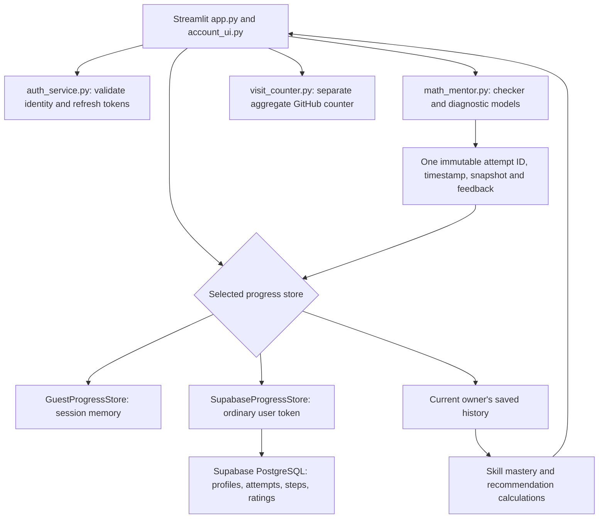

# Current application architecture

This document describes the current repository source, not evidence of which migrations or settings are active on the hosted service. The public app address supplied by the owner is https://math-mentorai.streamlit.app/; the current repository is https://github.com/Greenstar22/AI_Math_Mentor.

## Entry points and data flow

`app.py` renders Home, Analyze, Mastery, About, Settings, and Account. `account_ui.py` manages forms, imports, pending writes, preferences, and session transitions. `math_mentor.py` supplies the reviewed bank and mathematical/diagnostic calculations; it does not own normal app persistence.



All history-dependent normal runtime features use the selected store. Legacy SQLite helper functions are retained for explicit compatibility/tests; importing the engine does not initialize SQLite. `run_mentor_attempt(save=False, history=..., bandit=...)` is the analysis adapter path. Omitting `save=False` on the legacy helper still requests SQLite persistence; it is not the UI's account-storage API.

## Identity, configuration, and sessions

- Guests receive one random `guest_` UUID per guest session, with display name Guest. Account identity is the UUID returned by `auth.get_user`, with display name Student by default. Renaming never changes identity.
- Defaults are Dark appearance, Grades 9-12, socratic feedback, empty school/class and notes, and beginner for all five topics. The compact engine `StudentProfile` omits theme/school class; the store profile retains them.
- Supabase URL and publishable key come from `st.secrets['supabase']`. Ordinary authentication and database calls never use the administrator secret. Missing configuration leaves guest mode available; missing only the secret key affects deletion.
- The prototype requires email confirmation OFF, minimum password length 12, no recovery flow, no email-address change flow, and no Remember me. Passwords are masked and cleared from form state on the following rerun. Email is shown read-only; ownership is not verified.
- Auth clients, access/refresh tokens, private reports, drafts and pending operations remain in Streamlit session memory. Background SDK refresh is disabled; a session lock serializes explicit refresh when expiry is within 60 seconds and retains rotated tokens. `get_user` validates the established UUID before protected operations and private rendering.
- Invalid sessions clear local account state and ask for login. Temporary connectivity errors block private operations rather than substituting guest or SQLite data. Logout clears local private state even when remote local-scope revocation fails, and reports that failure. Unsaved work/imports require discard confirmation.
- Deletion validates the existing session, reauthenticates on a separate ordinary client, checks UUID agreement, and only then uses an isolated administrator client to hard-delete that UUID. Cascades are declared in the migration. Neither provider-backup deletion nor immediate revocation of every issued JWT is promised.

See [ACCOUNTS_SETUP.md](ACCOUNTS_SETUP.md) for exact settings, schemas and manual checks. These code paths and offline mocks are not evidence that hosted RLS, triggers or cascades have been exercised.

## Attempt persistence and feedback

An explicit Analyze submission generates one UUID and original timestamp, evaluates once, generates feedback once, and constructs an immutable JSON payload. `problem_version` is SHA-256 of canonical selected-problem JSON; `scoring_version` remains `v1`. The snapshot contains the selected problem's metadata, prompt, expected steps, final answer and hints, not the whole bank or account email/password fields.

Guests save once into session memory. Accounts send a batch to `save_attempts(p_attempts JSONB)`. The SECURITY INVOKER RPC derives ownership from `auth.uid()`, saves attempts/steps/imported ratings in one transaction, and compares immutable payloads on duplicate IDs. Consistently ordered advisory locks serialize competing IDs. Conflicting retries fail rather than overwrite records. A lost response can make save status uncertain; retrying the same ID/payload is the intended recovery path.

Pending account attempts are tied to the verified UUID and excluded from intentionally saved-history calculations until confirmation. After success, owned history is reloaded and mastery/recommendations recomputed. If the server committed but a confirmation read failed, that already-saved attempt can appear on a later refresh; the client cannot infer rollback from a timeout.

On login, account preferences load first. Existing guest attempts trigger an explicit batch import or discard choice; imports preserve IDs, timestamps, evaluations and ratings, while account preferences win. New analysis is blocked until resolved. Logout/session loss discards temporary import or unsaved work.

History reopens immutable snapshots, verdicts and generated feedback; it does not rerun grading. Current recommendations shown with an old review are recomputed from current saved history and the current bank. Exports are owner-scoped. Attempt and feedback loading paginate until no rows remain; the API's first page is not treated as complete history.

The rating RPC allows at most one saved rating per evaluated step, with the first successful insert winning. The present UI offers rating buttons for the first incorrect step in a saved review, not every step. Each session has its own `FeedbackBandit`, rebuilt from that owner's saved events. Epsilon is 0.15; untouched contexts prefer the learner's selected style, then exploration or the highest mean recorded reward determines the style. This is a small contextual-bandit demonstration, not measured evidence of learning gains. About-page product feedback is a separate local validation-only form.

## Bank, notation, and grading boundaries

The current bank has 50 unique IDs, five topics, five concepts per topic, two difficulty-distinct problems per concept, 212 reference lines, and 70 distinct skill labels. Grade bands and difficulty are author judgments, not empirically calibrated thresholds. `DEFAULT_STEPS` joins each problem's expected lines with newline characters. The historical Colab bank has six problems and is not its source of truth.

`clean_math_text` trims outer whitespace, removes a leading Step number, normalizes supported symbols and powers, and maps standalone uppercase `I` to `i`. `LOCAL_DICT` maps both to SymPy's imaginary constant. Reference matching tokenizes normalized text and ignores formatting whitespace while retaining operator, number, identifier and grouping tokens. It does not use `symbolic_equivalent()` for reference alignment, so different algebraic stages stay distinct. Explicit `*`, `**`/`^`, radians, and `Derivative`, `Integral` and `Limit` forms are supported by the parser. Some implicit multiplication parses, but that does not ensure identical reference-path credit. One equation per line is supported; natural-language proofs and arbitrary problem authoring are not.

The current evaluator behaves as follows:

1. Parse the line and search forward from the reference cursor for an identical normalized token sequence, ignoring formatting whitespace. A match marks that reference index covered. It can skip intervening references, reducing eventual coverage if never matched.
2. Otherwise, if the line is symbolically equivalent to the preceding submitted line, mark it `valid additional step` while on the reference path, or `carry-on error` after a deviation. Both have `is_correct=True` and no reference match. This compares a transition, not correctness relative to the original problem.
3. Otherwise, diagnose the mismatch, mark it incorrect, and advance the reference cursor. Classifier agreement on `correct` for a mismatch is reported as `unclassified`, not used to overrule the checker.

Thus an equivalent first line with structurally different notation may be rejected, whereas an equivalent continuation of an erroneous line may count as a correct transition. Branches, changes of quantity, domain restrictions, and complete alternative methods are not generally validated. The parser also assigns a positive assumption to `y`; symbolic equivalence operates under configured assumptions. A displayed skill on a non-reference line is the next reference target, not a verified operation classification.

For nonempty submissions:

```text
step_accuracy = count(is_correct) / submitted evaluated lines
coverage = distinct matched reference indices / expected reference lines
overall_score = 100 * (0.65 * step_accuracy + 0.35 * coverage)
```

Accuracy and coverage are rounded to three decimals; the overall score uses the unrounded inputs and is rounded to one decimal. Empty submissions score zero in the engine; the UI asks for at least one line. Reference-solution tests establish acceptance of the authored references, not correctness on arbitrary learner work.

The parser uses SymPy `parse_expr` without a restricted input grammar or execution sandbox. Normalization is not input sanitization. [SymPy documents the unsanitized-input risk](https://docs.sympy.org/latest/modules/parsing.html). Hardening it changes accepted input behavior and is deferred at the owner's request; RLS is not a substitute for parser isolation. No adversarial execution payload was run during this audit.

## Mastery and recommendation formulas

History is grouped by **topic and skill**, not simply by problem concept. With `n` evaluated steps, `c` marked correct, and `d` mean problem difficulty:

```text
error_rate = 1 - c/n
mastery = clip(((c+1)/(n+2)) * (1 + 0.05*(d-1)), 0, 1)
```

Topic displays weight these skill values by attempted steps. They do not average imported guest and account mastery percentages; the combined saved step history is aggregated again. Marked-correct additional/carried steps contribute to this formula under the current grading rules. This is heuristic progress information, not a psychometric assessment.

Each bank problem receives `2 - abs(difficulty-target_level)`, plus `2.5 * maximum topic error rate`, plus `0.8 * skill error rate` for **each expected step** using that skill, and `0.4` if unattempted. Repeated skills therefore contribute repeatedly. Ties sort by lower difficulty and then stable problem ID. This is deterministic heuristic ranking, not a learned ranking model. The UI user chooses a problem; starting levels influence recommendations rather than automatically changing the selected problem.

## Diagnostic model architecture and evidence

`build_synthetic_error_dataset` generates 36 examples for each of seven labels (252 total), using templated text rather than real learner outcomes. `train_test_split` uses a stratified 75/25 split and seed 42 (189 training, 63 held-out). The logistic pipeline uses TF-IDF unigrams/bigrams with a 2,000-feature cap and balanced logistic regression. The MLP uses a separate 500-feature-cap TF-IDF vectorizer, hidden layers `(64, 32)`, ReLU, Adam, up to 350 iterations and early stopping with a 15% internal validation split. Training occurs on Python module import, not through an OpenAI API or a downloaded LLM.

Feature caps are not fixed input dimensions. In the audited Python 3.12 environment, both fitted vocabularies had 331 features; the MLP shapes were `(331,64)`, `(64,32)`, `(32,7)` and 23,559 trainable weights/biases. For input width `d`, the parameter count is `(d+1)*64 + (64+1)*32 + (32+1)*7`. Dependency versions and corpus changes can affect fitted results; no deployment-independent parameter count or latency guarantee is implied.

Mismatch diagnosis applies parse/incomplete/sign/numeric-pattern rules first. When learned classifiers agree, the code uses their label and a transformed maximum confidence; otherwise it falls back to skill/algebra rules. The UI's confidence values include fixed constants and are not calibrated probabilities or a measure of model test accuracy. Offline unit tests and synthetic held-out data do not establish classroom accuracy, fairness, broad proof correctness, environmental savings or production security. No such empirical benchmark was performed in this audit.

## Separate integrations and historical material

The GitHub aggregate visit counter is independent of Supabase learning records. Its defaults target the fork's `visitor-stats` branch and `data/visit_counter.json`, with secret/environment overrides. It attempts an increment once per retained counter-state lifecycle and periodically reads the total. Account/guest state resets currently erase that flag and can trigger another increment in one browser session; the owner chose to retain that behavior for now. It stores no visitor identifiers in its JSON, but that is not a claim about GitHub or hosting-provider request logs.

`ui_source/` is an independently runnable React demo with mock classifiers, a separate demonstration bank and in-memory mastery; its appearance preference uses browser localStorage. Its account/password controls are placeholders and contact submission is simulated. These are not features of the current Supabase backend. The root Colab notebook preserves the earlier six-problem SQLite/optional-Gradio workflow. `CLEANUP_AUDIT.md` preserves a past cleanup snapshot; its old counts, identities and test results are historical, not current assertions.
